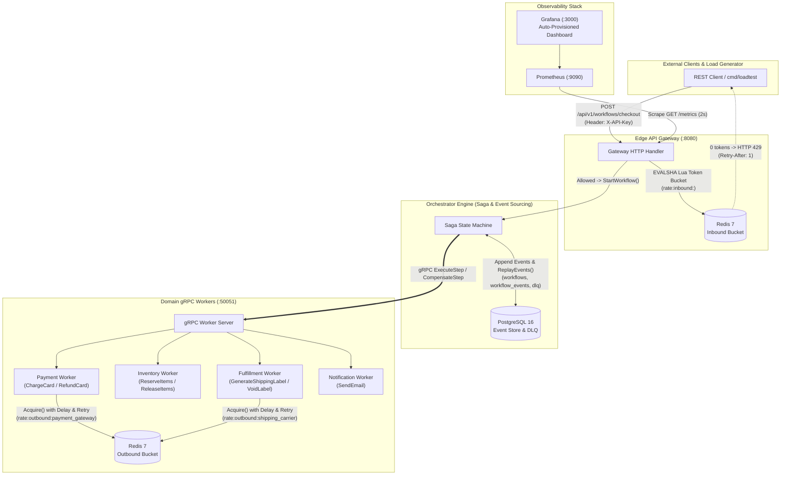
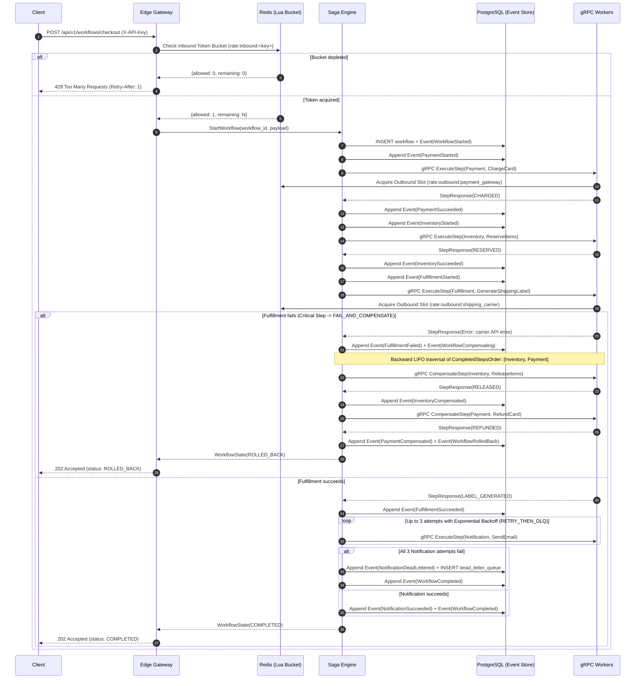

# Distributed Workflow Orchestrator & Edge Rate Limiter (Go)

A distributed workflow orchestrator written in Go, built around Event Sourcing in PostgreSQL, the Orchestrator-based Saga Pattern over gRPC, and two-tier Redis Token Bucket rate limiting (atomic Lua scripts for fail-fast inbound protection at the edge and delay-and-retry throttling on outbound third-party calls).

The system models a multi-service e-commerce checkout pipeline (`Payment -> Inventory -> Fulfillment -> Notification`) where distributed transactions cannot rely on a single ACID database or two-phase commit (2PC).

---

## Project objective and problem statement

In a distributed e-commerce architecture, completing an order requires coordinating state changes across independent domain services and external providers:

1. Charging the customer's credit card through an external payment gateway.
2. Reserving physical stock in the warehouse inventory service.
3. Generating a shipping label through an external logistics carrier API.
4. Sending a transactional confirmation email over SMTP.

This coordination introduces three systemic failure modes that this project addresses:

### 1. Partial failures across distributed services
If the payment card charge succeeds and inventory is reserved, but the shipping carrier API rejects the label generation, the system is left in an inconsistent state unless prior side effects are undone. Because external HTTP APIs do not participate in XA/2PC transactions, the orchestrator records every transition in an append-only event log and executes compensating transactions in strict reverse order (`ReleaseItems` followed by `RefundCard`).

### 2. Asymmetric failure criticality
Every step in a checkout pipeline does not carry the same business criticality. A failure in `Payment`, `Inventory`, or `Fulfillment` must abort the checkout and roll back completed steps. By contrast, if the order is paid, reserved, and labeled, a temporary SMTP failure in the `Notification` step should never refund the customer's money or cancel their shipment. The orchestrator applies per-step failure policies: critical steps use `FAIL_AND_COMPENSATE`, while `Notification` uses `RETRY_THEN_DLQ` (exponential backoff retries followed by persistence in a Dead Letter Queue while marking the workflow `COMPLETED`).

### 3. Traffic bursts at the edge vs. rate limits on downstream providers
A sudden traffic spike at the public API can overwhelm internal workers or trigger HTTP `429` bans from third-party payment and shipping APIs. This system separates rate limiting into two distinct behaviors:
- Inbound requests at the Edge API Gateway are evaluated per `X-API-Key` and rejected immediately with `429 Too Many Requests` when a client exhausts its token bucket.
- Outbound calls inside the `Payment` and `Fulfillment` gRPC workers check a separate Redis token bucket before calling external providers. When the outbound bucket is empty, the worker does not abort the Saga; it backs off, waits for token replenishment, and retries.

---

## Tech stack

| Layer | Technology | Purpose |
| :--- | :--- | :--- |
| Language | Go 1.27 | Concurrency primitives, HTTP/2 routing, gRPC server/client, and CLI load generator |
| Edge API Gateway | `net/http` (Go stdlib) | REST ingestion (`POST /api/v1/workflows/checkout`, `GET /api/v1/workflows/{id}`) |
| Internal RPC | gRPC & Protocol Buffers (`proto3`) | Binary RPC contract (`ExecuteStep`, `CompensateStep`) between Orchestrator and Workers |
| Event Store & DLQ | PostgreSQL 16 (`database/sql`, `lib/pq`) | Transactional persistence for `workflows`, `workflow_events`, and `dead_letter_queue` |
| Rate Limiting | Redis 7 + Lua scripts (`go-redis/v9`) | Atomic Token Bucket state (`tokens`, `last_updated`) with millisecond refill accuracy |
| Observability | Prometheus & Grafana | Scraping `/metrics` every 2s and rendering an auto-provisioned 12-panel dashboard |
| Testing | `miniredis/v2`, `httptest`, `testing` | Hermetic unit, benchmark, and end-to-end HTTP-to-gRPC integration tests |

---

## System architecture

### High-level topology



### Saga execution, rollback, and DLQ sequence



---

## Architectural breakdown

### 1. Edge API Gateway and atomic Lua Token Bucket (`internal/limiter`, `internal/gateway`)
Every request hitting `POST /api/v1/workflows/checkout` must provide an `X-API-Key` header. To avoid the race conditions inherent in a naive `GET` followed by `SET` in Redis across concurrent gateway instances, the token bucket math runs inside a single Lua script executed via `EVALSHA`:

```lua
local data = redis.call('HMGET', key, 'tokens', 'last_updated')
local tokens = tonumber(data[1])
local last_updated = tonumber(data[2])

if tokens == nil or last_updated == nil then
    tokens = capacity
    last_updated = now
else
    local delta = math.max(0, now - last_updated)
    local refilled = delta * refill_rate_per_ms
    tokens = math.min(capacity, tokens + refilled)
    last_updated = now
end

local allowed = 0
if tokens >= requested then
    tokens = tokens - requested
    allowed = 1
end

redis.call('HMSET', key, 'tokens', tokens, 'last_updated', last_updated)
redis.call('EXPIRE', key, ttl)
return { allowed, math.floor(tokens) }
```

Calculating refill delta at millisecond resolution (`refill_rate / 1000.0`) allows smooth continuous token generation without fixed-window boundary spikes. Idle keys expire automatically via `EXPIRE`.

### 2. Event Sourcing and deterministic state reconstruction (`internal/eventsourcing`)
Instead of mutating a complex row with dozens of nullable columns (`payment_status`, `inventory_status`, `refund_tx_id`, `attempt_count`), the database schema stores an append-only stream of domain events in `workflow_events`:

- `workflows`: holds high-level metadata (`id`, `workflow_type`, `status`, `created_at`, `updated_at`).
- `workflow_events`: stores every state transition (`id BIGSERIAL`, `workflow_id`, `event_type`, `step_name`, `payload JSONB`, `timestamp`), indexed by `(workflow_id, id ASC)`.
- `dead_letter_queue`: stores exhausted non-critical step payloads (`id`, `workflow_id`, `step_name`, `reason`, `payload JSONB`, `created_at`).

Before every decision in the state machine, the engine calls `ReconstructState(ctx, workflowID)`, which queries the event log in ascending ID order and runs `ReplayEvents`. This function folds the event stream into a `WorkflowState` struct containing the current `StepStates` map and the `CompletedStepsOrder` slice.

### 3. Saga state machine and reverse compensation traversal (`internal/orchestrator`)
The Checkout Saga blueprint (`NewCheckoutSagaBlueprint`) defines the 4 steps and their policies:

| Order | Step | Forward Action | Compensation Action | Failure Policy | Max Retries |
| :---: | :--- | :--- | :--- | :--- | :---: |
| 1 | `Payment` | `ChargeCard` | `RefundCard` | `FAIL_AND_COMPENSATE` | 1 |
| 2 | `Inventory` | `ReserveItems` | `ReleaseItems` | `FAIL_AND_COMPENSATE` | 1 |
| 3 | `Fulfillment` | `GenerateShippingLabel` | `VoidLabel` | `FAIL_AND_COMPENSATE` | 1 |
| 4 | `Notification` | `SendEmail` | None | `RETRY_THEN_DLQ` | 3 (Exponential Backoff) |

During forward execution, each step that finishes appends its name to `CompletedStepsOrder`. If a step with `FAIL_AND_COMPENSATE` fails, the engine appends `WorkflowCompensating` and iterates backward through `CompletedStepsOrder` (`for i := len(state.CompletedStepsOrder) - 1; i >= 0; i--`). Each previously completed step with `HasCompensation == true` is compensated via gRPC, recorded with a `<Step>Compensated` event, and finalized with `WorkflowRolledBack`.

### 4. gRPC workers and outbound rate limiting (`internal/worker`, `proto/worker/v1`)
The Orchestrator Engine communicates with domain workers through a gRPC contract (`WorkerService.ExecuteStep` and `WorkerService.CompensateStep`).

Before `PaymentWorker` or `FulfillmentWorker` executes its simulated external API call, it calls `outboundLimiter.Acquire(ctx, serviceName)`. Unlike the Edge Gateway limiter, `Acquire` loops when the bucket is empty: it increments the Prometheus metric `orchestrator_outbound_rate_limit_delays_total`, sleeps for the configured retry interval, and re-evaluates the Redis Lua script until a token is acquired or the context deadline expires.

---

## Engineering trade-offs and design decisions

### 1. Central Orchestration vs. Event Choreography
- Decision: Use a central Orchestrator Engine driving passive gRPC workers rather than decentralized pub/sub choreography where each service listens to events from the previous service.
- Rationale: In a 4-step checkout flow with backward compensations, choreography spreads the rollback topology across 4 independent codebases, creating cyclic event dependencies when adding or reordering steps. Centralizing the state machine in `internal/orchestrator` keeps the blueprint, retry policies, and LIFO rollback order explicit in a single place.
- Trade-off: The Orchestrator Engine is a coordination dependency on the write path. We mitigate single-point-of-failure state loss by making the Engine stateless in memory: all state lives in PostgreSQL `workflow_events` and can be reconstructed at any point via `ReplayEvents`.

### 2. Event Sourcing replay on every step vs. mutable state snapshots
- Decision: Reconstruct `WorkflowState` by replaying the workflow's events from `workflow_events` on each step transition without an intermediate snapshot table.
- Rationale: A checkout Saga produces between 8 and 18 events over its entire lifetime. As shown in our benchmarks below, folding 10 events in Go takes `~2.14 microseconds` (`1,568 bytes` allocated). Building a snapshot cache or dual-writing mutable columns would add complexity and synchronization bugs for zero measurable gain on short-lived streams.
- Trade-off: If the orchestrator were repurposed for long-running workflows generating 10,000+ events per workflow ID, linear replay cost would grow to milliseconds, requiring periodic state snapshots every $N$ events.

### 3. Fail-fast inbound rate limiting vs. delay-and-retry outbound throttling
- Decision: Return HTTP `429` immediately at the Edge Gateway, but block-and-retry inside the gRPC workers when outbound limits are hit.
- Rationale: At the edge, queuing excess external client traffic consumes file descriptors and goroutines, increasing tail latency for well-behaved tenants. Inside an already accepted Saga, however, `Payment` or `Inventory` may have already mutated state; failing `Fulfillment` simply because the shipping carrier rate bucket is momentarily empty would trigger unnecessary refunds and stock releases. Delaying the worker goroutine by 50ms until the token bucket refills preserves transaction completion rates.
- Trade-off: Under extreme downstream saturation, holding worker goroutines in a wait loop increases in-flight concurrency and end-to-end Saga duration (`P95`/`P99`), bounded by `maxWaitLoops` and context timeouts.

### 4. PostgreSQL with in-memory fallback (`PostgresRepository` vs. `InMemoryRepository`)
- Decision: Implement the `eventsourcing.Repository` interface for both PostgreSQL (transactional ACID event log) and a thread-safe in-memory store (`sync.RWMutex`), defaulting to PostgreSQL and falling back to in-memory if PostgreSQL is unreachable at boot.
- Rationale: Developers and CI pipelines can run `go test ./...` or `go run main.go` on a clean machine without Docker running, while production and Docker Compose runs use full PostgreSQL persistence.
- Trade-off: The in-memory fallback is non-durable across process restarts and is intended strictly for local development and hermetic testing.

### 5. Synchronous HTTP checkout execution vs. asynchronous background workers
- Decision: `POST /api/v1/workflows/checkout` executes the Saga evaluation loop before returning `202 Accepted` with the complete `workflow_state` payload (while also exposing `GET /api/v1/workflows/{id}`).
- Rationale: Returning the final reconstructed event stream directly in the response makes testing, load test verification, and observability inspection immediate without requiring client polling loops.
- Trade-off: HTTP connection lifetime is tied to the Saga execution duration (`~2ms` normal, `~40-150ms` when throttled by outbound rate limits or notification backoff). In a high-latency production environment where external providers take seconds to respond, `CreateWorkflow` would return `202 Accepted` immediately with `status: PENDING`, and a pool of background pollers/consumers would call `engine.Evaluate(ctx, workflowID)` asynchronously.

---

## Benchmarks and load testing

### Event Sourcing replay benchmark

Executed on `go1.27.0 windows/amd64` (`12th Gen Intel Core i5-12400F`):

```text
$ go test "-bench=." -benchmem ./internal/eventsourcing

goos: windows
goarch: amd64
pkg: github.com/DaniloNogueira-Silva/go-distributed_worflow-orchestrator/internal/eventsourcing
cpu: 12th Gen Intel(R) Core(TM) i5-12400F
BenchmarkReplayEvents_FullCheckoutSaga-12    	  506980	      2141 ns/op	    1568 B/op	      20 allocs/op
PASS
```

Replaying the 10 domain events of a complete Checkout Saga (`WorkflowStarted` through `WorkflowCompleted`) and building the deterministic `WorkflowState` takes `2.14 µs/op` (~467,000 state reconstructions/sec per core).

### High-concurrency stress test (`cmd/loadtest`)

The repository includes a multi-goroutine load generator (`cmd/loadtest/main.go`) that stresses all execution paths simultaneously:
- Simulates multiple concurrent `X-API-Key` tenants to trigger both `202 Accepted` workflows and `429 Too Many Requests` edge blocks.
- Injects configurable failure rates into `Fulfillment` and `Inventory` (`-rollback-rate`) to stress backward Saga compensations over gRPC.
- Injects configurable failure rates into `Notification` (`-dlq-rate`) to stress exponential backoff retries and Dead Letter Queue persistence.
- Saturates the outbound payment and shipping rate limiters to trigger worker delay-and-retry loops.

```bash
go run ./cmd/loadtest/main.go \
  -concurrency 50 \
  -duration 60s \
  -clients 25 \
  -rollback-rate 0.25 \
  -dlq-rate 0.10 \
  -think-time 0s
```

---

## Repository structure

```text
Go-Distributed_Orchestrator/
├── cmd/
│   ├── gateway/
│   │   └── main.go                       # Service entrypoint
│   └── loadtest/
│       └── main.go                       # High-concurrency stress & load test CLI
├── config/
│   └── config.go                         # Environment configuration loader
├── internal/
│   ├── app/
│   │   └── bootstrap.go                  # Dependency wiring & graceful shutdown
│   ├── eventsourcing/
│   │   ├── models.go                     # Domain events, states & ReplayEvents() fold logic
│   │   ├── repository.go                 # PostgreSQL & In-Memory Event Store + DLQ
│   │   └── repository_test.go            # State reconstruction unit tests & benchmarks
│   ├── gateway/
│   │   ├── handler.go                    # REST endpoints (/checkout, /workflows/{id}, /metrics)
│   │   └── handler_test.go               # Gateway rate limit & status code tests
│   ├── limiter/
│   │   ├── token_bucket.go               # Atomic Redis + Lua Token Bucket implementation
│   │   ├── token_bucket_test.go          # Deterministic mock-clock token refill tests
│   │   └── outbound.go                   # Delay-and-retry outbound rate limiter wrapper
│   ├── metrics/
│   │   └── metrics.go                    # Prometheus counters, gauges, and histograms
│   ├── orchestrator/
│   │   ├── blueprint.go                  # 4-step Checkout Saga blueprint & failure policies
│   │   ├── engine.go                     # Saga state machine & reverse compensation loop
│   │   └── engine_test.go                # Happy path, rollback, and DLQ unit tests
│   └── worker/
│       ├── workers.go                    # Payment, Inventory, Fulfillment & Notification logic
│       └── grpc_service.go               # gRPC WorkerServiceServer & WorkerExecutor client adapter
├── migrations/
│   └── 001_init_schema.sql               # PostgreSQL DDL (workflows, workflow_events, dead_letter_queue)
├── monitoring/
│   ├── prometheus/
│   │   └── prometheus.yml                # Scrape config (2s interval on host.docker.internal:8080)
│   └── grafana/
│       ├── dashboards/
│       │   └── orchestrator_dashboard.json # Auto-provisioned 12-panel Grafana dashboard
│       └── provisioning/                 # Automatic Prometheus datasource & dashboard loader
├── proto/
│   └── worker/v1/
│       ├── worker.proto                  # Protocol Buffers contract for WorkerService
│       └── worker_grpc.pb.go             # Go gRPC client/server bindings
├── scripts/
│   ├── simulate_scenarios.ps1            # PowerShell scenario runner
│   └── simulate_scenarios.sh             # Bash/curl scenario runner
├── docker-compose.yml                    # PostgreSQL 16, Redis 7, Prometheus, and Grafana
├── integration_test.go                   # End-to-end HTTP -> Engine -> gRPC -> Event Store tests
└── main.go                               # Root application entrypoint
```

---

## Getting started and verification guide

### 1. Run unit tests, integration tests, and benchmarks (no Docker required)

All tests use `miniredis` and an ephemeral TCP gRPC listener, so they run self-contained without external containers:

```bash
go test -v ./...
go test "-bench=." -benchmem ./internal/eventsourcing
```

### 2. Start infrastructure and observability stack

```bash
docker compose up -d
```

This starts four containers:
- PostgreSQL 16 on `localhost:5432`
- Redis 7 on `localhost:6379`
- Prometheus on `http://localhost:9090`
- Grafana on `http://localhost:3000` (anonymous admin enabled; opens the Saga Orchestrator dashboard directly)

### 3. Run the orchestrator application

```bash
go run main.go
```

On startup, the application connects to Redis, verifies and applies the PostgreSQL schema (`workflows`, `workflow_events`, `dead_letter_queue`), starts the gRPC Worker Server on `localhost:50051`, and starts the Edge API Gateway on `http://localhost:8080`.

### 4. Test individual Saga scenarios manually

#### Scenario A: Successful checkout (`COMPLETED`)

```bash
curl -i -X POST http://localhost:8080/api/v1/workflows/checkout \
  -H "Content-Type: application/json" \
  -H "X-API-Key: manual-client-1" \
  -d '{
    "customer_id": "cust_100",
    "amount": 299.90,
    "currency": "BRL",
    "items": ["mechanical_keyboard", "wrist_rest"]
  }'
```

#### Scenario B: Inspect reconstructed Event Sourcing state by workflow ID

```bash
curl -s http://localhost:8080/api/v1/workflows/<WORKFLOW_ID>
```

#### Scenario C: Fulfillment failure triggering reverse compensations (`ROLLED_BACK`)

Pass `"simulate_fail_step": "Fulfillment"` to simulate a carrier failure after `Payment` and `Inventory` have already succeeded:

```bash
curl -i -X POST http://localhost:8080/api/v1/workflows/checkout \
  -H "Content-Type: application/json" \
  -H "X-API-Key: manual-client-2" \
  -d '{
    "customer_id": "cust_200",
    "amount": 1500.00,
    "currency": "BRL",
    "items": ["ultrawide_monitor"],
    "simulate_fail_step": "Fulfillment"
  }'
```

The returned `workflow_state.events` array shows `PaymentSucceeded`, `InventorySucceeded`, `FulfillmentFailed`, `WorkflowCompensating`, `InventoryCompensated` (`ReleaseItems`), `PaymentCompensated` (`RefundCard`), and `WorkflowRolledBack`.

#### Scenario D: Non-critical notification failure routing to Dead Letter Queue (`COMPLETED`)

Pass `"simulate_fail_step": "Notification"` to simulate an SMTP outage:

```bash
curl -i -X POST http://localhost:8080/api/v1/workflows/checkout \
  -H "Content-Type: application/json" \
  -H "X-API-Key: manual-client-3" \
  -d '{
    "customer_id": "cust_300",
    "amount": 89.90,
    "currency": "BRL",
    "items": ["go_programming_book"],
    "simulate_fail_step": "Notification"
  }'
```

The engine retries `Notification` 3 times with exponential backoff, records `NotificationDeadLettered`, inserts the failure into `dead_letter_queue`, and completes the checkout (`status: COMPLETED`) without rolling back the payment or shipment.

### 5. Inspect PostgreSQL Event Store and Redis Token Buckets directly

```bash
# View recent workflows
docker exec -it orchestrator-postgres psql -U postgres -d orchestrator_db \
  -c "SELECT id, status, created_at FROM workflows ORDER BY created_at DESC LIMIT 10;"

# View immutable event stream
docker exec -it orchestrator-postgres psql -U postgres -d orchestrator_db \
  -c "SELECT id, workflow_id, event_type, step_name, timestamp FROM workflow_events ORDER BY id DESC LIMIT 20;"

# View Dead Letter Queue entries
docker exec -it orchestrator-postgres psql -U postgres -d orchestrator_db \
  -c "SELECT id, workflow_id, step_name, reason, created_at FROM dead_letter_queue;"

# Inspect active Token Buckets in Redis
docker exec -it orchestrator-redis redis-cli KEYS "rate:*"
docker exec -it orchestrator-redis redis-cli HGETALL "rate:inbound:manual-client-1"
```

### 6. Run the concurrent stress test and watch Grafana

1. Open `http://localhost:3000` in your browser.
2. Execute the load test CLI:

```bash
go run ./cmd/loadtest/main.go -concurrency 30 -duration 45s -clients 15 -rollback-rate 0.20 -dlq-rate 0.10
```

The Grafana dashboard updates every 5 seconds with live curves for:
- Edge Gateway `202 Accepted` vs. `429 Blocked` request rates.
- Saga workflow completion vs. rollback rates and active in-flight workflows.
- Per-step execution and compensation throughput (`Payment`, `Inventory`, `Fulfillment`, `Notification`).
- End-to-end Saga duration percentiles (`P50`, `P95`, `P99`).
- Outbound rate limiter delay-and-retry counts per external provider (`payment_gateway`, `shipping_carrier`).
- Cumulative Event Sourcing events persisted by event type.
