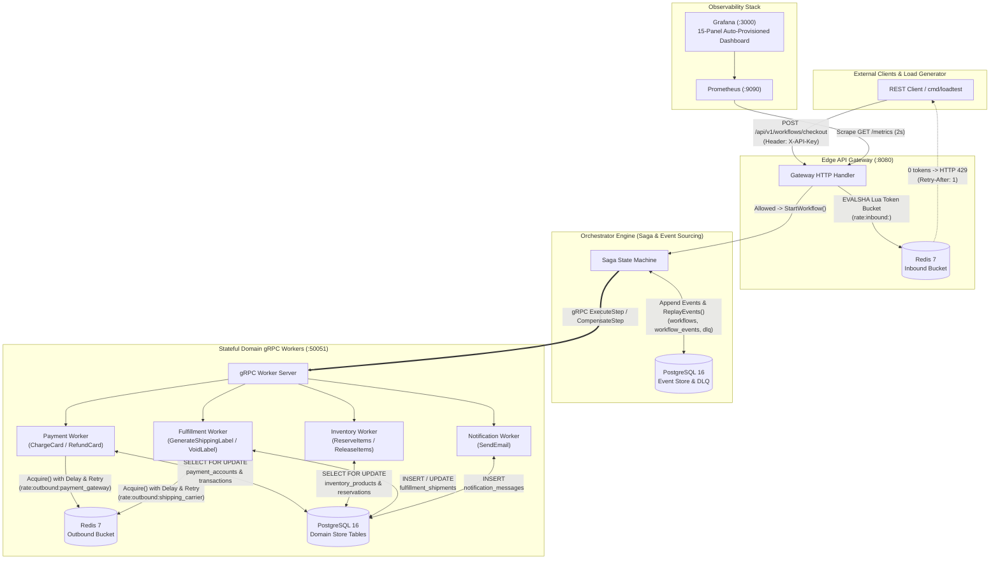

# Distributed Workflow Orchestrator & Edge Rate Limiter (Go)

A distributed workflow orchestrator written in Go, built around Event Sourcing in PostgreSQL, the Orchestrator-based Saga Pattern over gRPC, stateful domain workers (wallet ledger, warehouse stock locking, carrier shipment persistence, and transactional email outbox), and two-tier Redis Token Bucket rate limiting (atomic Lua scripts for fail-fast inbound protection at the edge and delay-and-retry throttling on outbound third-party calls).

The system executes an e-commerce checkout pipeline (`Payment -> Inventory -> Fulfillment -> Notification`) where distributed transactions cannot rely on a single ACID database or two-phase commit (2PC).

---

## Project objective and problem statement

In a distributed e-commerce architecture, completing an order requires coordinating state mutations across independent domain stores and external providers:

1. Debiting the customer's credit balance and recording a ledger entry in the payment service (`payment_accounts`, `payment_transactions`).
2. Locking and deducting physical stock quantities in the warehouse catalog (`inventory_products`, `inventory_reservations`).
3. Validating parcel compliance and persisting a shipping label with an external logistics carrier (`fulfillment_shipments`).
4. Delivering and recording a transactional confirmation email in the notification outbox (`notification_messages`).

This coordination introduces three systemic failure modes that this project addresses:

### 1. Partial failures across stateful services
If the customer's balance is debited and physical warehouse stock is deducted, but the shipping carrier rejects the parcel (for example, when an order contains a prohibited item like `restricted_hazard_item`) or a stock shortage occurs mid-checkout (`out_of_stock_item`), prior side effects must be reversed. The orchestrator records every transition in an append-only event log and executes compensating transactions in reverse LIFO order: `ReleaseItems` restores the exact product quantities back to `available_stock`, and `RefundCard` marks the ledger transaction `REFUNDED` while crediting the funds back to the customer's balance.

### 2. Asymmetric failure criticality
Every step in a checkout pipeline does not carry the same business criticality. A failure in `Payment`, `Inventory`, or `Fulfillment` must abort the checkout and roll back completed steps. By contrast, if the order is paid, reserved, and labeled, an SMTP delivery failure in the `Notification` step (such as `unsubscribed_customer`) should never refund the customer's money or cancel their shipment. The orchestrator applies per-step failure policies: critical steps use `FAIL_AND_COMPENSATE`, while `Notification` uses `RETRY_THEN_DLQ` (exponential backoff retries followed by persistence in `dead_letter_queue` while marking the workflow `COMPLETED`).

### 3. Traffic bursts at the edge vs. rate limits on downstream providers
A sudden traffic spike at the public API can overwhelm internal workers or trigger HTTP `429` bans from third-party payment and shipping APIs. This system separates rate limiting into two distinct behaviors:
- Inbound requests at the Edge API Gateway are evaluated per `X-API-Key` and rejected immediately with `429 Too Many Requests` when a client exhausts its token bucket.
- Outbound calls inside the `Payment` and `Fulfillment` gRPC workers check a separate Redis token bucket before executing provider calls. When the outbound bucket is empty, the worker does not abort the Saga; it backs off, waits for token replenishment, and retries.

---

## Tech stack

| Layer | Technology | Purpose |
| :--- | :--- | :--- |
| Language | Go 1.27 | Concurrency primitives, HTTP/2 routing, gRPC server/client, and CLI load generator |
| Edge API Gateway | `net/http` (Go stdlib) | REST ingestion (`/checkout`, `/workflows/{id}`, `/domain/state`, `/metrics`) |
| Internal RPC | gRPC & Protocol Buffers (`proto3`) | Binary RPC contract (`ExecuteStep`, `CompensateStep`) between Orchestrator and Workers |
| Event Store & Domain DB | PostgreSQL 16 (`database/sql`, `lib/pq`) | ACID persistence for Event Sourcing (`workflows`, `workflow_events`, `dead_letter_queue`) and Domain tables (`payment_accounts`, `payment_transactions`, `inventory_products`, `inventory_reservations`, `fulfillment_shipments`, `notification_messages`) |
| Rate Limiting | Redis 7 + Lua scripts (`go-redis/v9`) | Atomic Token Bucket state (`tokens`, `last_updated`) with millisecond refill accuracy |
| Observability | Prometheus & Grafana | Scraping `/metrics` every 2s and rendering an auto-provisioned 15-panel dashboard |
| Testing | `miniredis/v2`, `httptest`, `testing` | Hermetic unit, domain store, benchmark, and end-to-end HTTP-to-gRPC integration tests |

---

## System architecture

### High-level topology



### Saga execution, rollback, and DLQ sequence

```mermaid
sequenceDiagram
    autonumber
    participant C as Client
    participant GW as Edge Gateway
    participant R as Redis (Lua Bucket)
    participant E as Saga Engine
    participant PG as PostgreSQL (Events & Domain)
    participant W as gRPC Workers

    C->>GW: POST /api/v1/workflows/checkout (X-API-Key)
    GW->>R: Check Inbound Token Bucket (rate:inbound:<key>)
    alt Bucket depleted
        R-->>GW: {allowed: 0, remaining: 0}
        GW-->>C: 429 Too Many Requests (Retry-After: 1)
    else Token acquired
        R-->>GW: {allowed: 1, remaining: N}
        GW->>E: StartWorkflow(workflow_id, payload)
        E->>PG: INSERT workflow + Event(WorkflowStarted)

        E->>PG: Append Event(PaymentStarted)
        E->>W: gRPC ExecuteStep(Payment, ChargeCard)
        W->>R: Acquire Outbound Slot (rate:outbound:payment_gateway)
        W->>PG: Debit payment_accounts & INSERT payment_transactions(CHARGED)
        W-->>E: StepResponse(CHARGED, remaining_balance)
        E->>PG: Append Event(PaymentSucceeded)

        E->>PG: Append Event(InventoryStarted)
        E->>W: gRPC ExecuteStep(Inventory, ReserveItems)
        W->>PG: SELECT FOR UPDATE inventory_products (available -= qty, reserved += qty)
        W-->>E: StepResponse(RESERVED, stock_after_operation)
        E->>PG: Append Event(InventorySucceeded)

        E->>PG: Append Event(FulfillmentStarted)
        E->>W: gRPC ExecuteStep(Fulfillment, GenerateShippingLabel)
        W->>R: Acquire Outbound Slot (rate:outbound:shipping_carrier)

        alt Fulfillment fails (e.g., restricted_hazard_item -> FAIL_AND_COMPENSATE)
            W-->>E: StepResponse(Error: carrier rejected parcel)
            E->>PG: Append Event(FulfillmentFailed) + Event(WorkflowCompensating)
            Note over E,W: Backward LIFO traversal of CompletedStepsOrder: [Inventory, Payment]
            E->>W: gRPC CompensateStep(Inventory, ReleaseItems)
            W->>PG: Restore inventory_products (available += qty, reserved -= qty) & status=RELEASED
            W-->>E: StepResponse(RELEASED, stock_after_operation)
            E->>PG: Append Event(InventoryCompensated)
            E->>W: gRPC CompensateStep(Payment, RefundCard)
            W->>PG: Credit payment_accounts (balance += amount) & status=REFUNDED
            W-->>E: StepResponse(REFUNDED, restored_balance)
            E->>PG: Append Event(PaymentCompensated) + Event(WorkflowRolledBack)
            E-->>GW: WorkflowState(ROLLED_BACK)
            GW-->>C: 202 Accepted (status: ROLLED_BACK)
        else Fulfillment succeeds
            W->>PG: INSERT fulfillment_shipments(LABEL_GENERATED, tracking_code)
            W-->>E: StepResponse(LABEL_GENERATED)
            E->>PG: Append Event(FulfillmentSucceeded)
            loop Up to 3 attempts with Exponential Backoff (RETRY_THEN_DLQ)
                E->>W: gRPC ExecuteStep(Notification, SendEmail)
            end
            alt All 3 Notification attempts fail (e.g., unsubscribed_customer)
                E->>PG: Append Event(NotificationDeadLettered) + INSERT dead_letter_queue
                E->>PG: Append Event(WorkflowCompleted)
            else Notification succeeds
                W->>PG: INSERT notification_messages(SENT, recipient_email, subject)
                E->>PG: Append Event(NotificationSucceeded) + Event(WorkflowCompleted)
            end
            E-->>GW: WorkflowState(COMPLETED)
            GW-->>C: 202 Accepted (status: COMPLETED)
        end
    end
```



---

## Architectural breakdown

### 1. Edge API Gateway and atomic Lua Token Bucket (`internal/limiter`, `internal/gateway`)
Every request hitting `POST /api/v1/workflows/checkout` must provide an `X-API-Key` header. To avoid the race conditions inherent in a naive `GET` followed by `SET` in Redis across concurrent gateway instances, the token bucket math runs inside a single Lua script executed via `EVALSHA`:

```lua
local data = redis.call('HMGET', key, 'tokens', 'last_updated')
local tokens = tonumber(data[1])
local last_updated = tonumber(data[2])

if tokens == nil or last_updated == nil then
    tokens = capacity
    last_updated = now
else
    local delta = math.max(0, now - last_updated)
    local refilled = delta * refill_rate_per_ms
    tokens = math.min(capacity, tokens + refilled)
    last_updated = now
end

local allowed = 0
if tokens >= requested then
    tokens = tokens - requested
    allowed = 1
end

redis.call('HMSET', key, 'tokens', tokens, 'last_updated', last_updated)
redis.call('EXPIRE', key, ttl)
return { allowed, math.floor(tokens) }
```

Calculating refill delta at millisecond resolution (`refill_rate / 1000.0`) allows smooth continuous token generation without fixed-window boundary spikes. Idle keys expire automatically via `EXPIRE`.

### 2. Event Sourcing and deterministic state reconstruction (`internal/eventsourcing`)
Instead of mutating a single row with dozens of nullable columns (`payment_status`, `inventory_status`, `refund_tx_id`, `attempt_count`), the orchestration schema stores an append-only stream of domain events in `workflow_events`:

- `workflows`: holds high-level metadata (`id`, `workflow_type`, `status`, `created_at`, `updated_at`).
- `workflow_events`: stores every state transition (`id BIGSERIAL`, `workflow_id`, `event_type`, `step_name`, `payload JSONB`, `timestamp`), indexed by `(workflow_id, id ASC)`.
- `dead_letter_queue`: stores exhausted non-critical step payloads (`id`, `workflow_id`, `step_name`, `reason`, `payload JSONB`, `created_at`).

Before every decision in the state machine, the engine calls `ReconstructState(ctx, workflowID)`, which queries the event log in ascending ID order and runs `ReplayEvents`. This function folds the event stream into a `WorkflowState` struct containing the current `StepStates` map and the `CompletedStepsOrder` slice.

### 3. Saga state machine and reverse compensation traversal (`internal/orchestrator`)
The Checkout Saga blueprint (`NewCheckoutSagaBlueprint`) defines the 4 steps and their policies:

| Order | Step | Forward Action | Compensation Action | Failure Policy | Max Retries |
| :---: | :--- | :--- | :--- | :--- | :---: |
| 1 | `Payment` | `ChargeCard` | `RefundCard` | `FAIL_AND_COMPENSATE` | 1 |
| 2 | `Inventory` | `ReserveItems` | `ReleaseItems` | `FAIL_AND_COMPENSATE` | 1 |
| 3 | `Fulfillment` | `GenerateShippingLabel` | `VoidLabel` | `FAIL_AND_COMPENSATE` | 1 |
| 4 | `Notification` | `SendEmail` | None | `RETRY_THEN_DLQ` | 3 (Exponential Backoff) |

During forward execution, each step that finishes appends its name to `CompletedStepsOrder`. If a step with `FAIL_AND_COMPENSATE` fails, the engine appends `WorkflowCompensating` and iterates backward through `CompletedStepsOrder` (`for i := len(state.CompletedStepsOrder) - 1; i >= 0; i--`). Each previously completed step with `HasCompensation == true` is compensated via gRPC, recorded with a `<Step>Compensated` event, and finalized with `WorkflowRolledBack`.

### 4. Stateful gRPC workers and domain persistence (`internal/worker`)
Each worker executes real business logic backed by the `DomainStore` (`PostgresDomainStore` in PostgreSQL or `InMemoryDomainStore` in hermetic tests):

- `PaymentWorker`: maintains customer credit accounts (`payment_accounts`, default initial balance `25,000.00 BRL`, or `10.00 BRL` for `broke_customer`) and a transaction ledger (`payment_transactions`). `ChargeCard` locks the customer row (`SELECT ... FOR UPDATE`), verifies sufficient funds, deducts the order amount, and inserts a `CHARGED` ledger row. `RefundCard` marks the ledger row `REFUNDED`, generates a `refund_id`, and credits the exact amount back to the customer's balance.
- `InventoryWorker`: manages product catalog stock (`inventory_products`, pre-seeded with `5,000` units per SKU, plus `out_of_stock_item` seeded with `0` units) and reservations (`inventory_reservations`). To prevent deadlocks under concurrent checkouts, `ReserveItems` sorts requested SKUs alphabetically before acquiring row locks, verifies `available_stock >= requested_qty` across all items atomically, decrements `available_stock`, and increments `reserved_stock`. `ReleaseItems` restores the units back to `available_stock`, decrements `reserved_stock`, and updates the reservation to `RELEASED`.
- `FulfillmentWorker`: validates parcel items against carrier compliance rules (rejecting `restricted_hazard_item`), generates a tracking code (`TRK-BR-...`), and inserts a shipment record into `fulfillment_shipments` (`LABEL_GENERATED`). `VoidLabel` updates the shipment record to `VOIDED`.
- `NotificationWorker`: validates the recipient (rejecting `unsubscribed_customer` and `invalid_email`), composes the confirmation email with the order total and item summary, and persists the message to `notification_messages` (`SENT`).

---

## Engineering trade-offs and design decisions

### 1. Central Orchestration vs. Event Choreography
- Decision: Use a central Orchestrator Engine driving passive gRPC workers rather than decentralized pub/sub choreography where each service listens to events from the previous service.
- Rationale: In a 4-step checkout flow with backward compensations, choreography spreads the rollback topology across 4 independent codebases, creating cyclic event dependencies when adding or reordering steps. Centralizing the state machine in `internal/orchestrator` keeps the blueprint, retry policies, and LIFO rollback order explicit in a single place.
- Trade-off: The Orchestrator Engine is a coordination dependency on the write path. We mitigate single-point-of-failure state loss by making the Engine stateless in memory: all state lives in PostgreSQL `workflow_events` and can be reconstructed at any point via `ReplayEvents`.

### 2. Event Sourcing replay on every step vs. mutable state snapshots
- Decision: Reconstruct `WorkflowState` by replaying the workflow's events from `workflow_events` on each step transition without an intermediate snapshot table.
- Rationale: A checkout Saga produces between 8 and 18 events over its entire lifetime. As shown in our benchmarks below, folding 10 events in Go takes `~2.14 microseconds` (`1,568 bytes` allocated). Building a snapshot cache or dual-writing mutable columns would add complexity and synchronization bugs for zero measurable gain on short-lived streams.
- Trade-off: If the orchestrator were repurposed for long-running workflows generating 10,000+ events per workflow ID, linear replay cost would grow to milliseconds, requiring periodic state snapshots every $N$ events.

### 3. Fail-fast inbound rate limiting vs. delay-and-retry outbound throttling
- Decision: Return HTTP `429` immediately at the Edge Gateway, but block-and-retry inside the gRPC workers when outbound limits are hit.
- Rationale: At the edge, queuing excess external client traffic consumes file descriptors and goroutines, increasing tail latency for well-behaved tenants. Inside an already accepted Saga, however, `Payment` or `Inventory` has already mutated database state; failing `Fulfillment` simply because the shipping carrier rate bucket is momentarily empty would trigger unnecessary refunds and stock releases. Delaying the worker goroutine by 50ms until the token bucket refills preserves transaction completion rates.
- Trade-off: Under extreme downstream saturation, holding worker goroutines in a wait loop increases in-flight concurrency and end-to-end Saga duration (`P95`/`P99`), bounded by `maxWaitLoops` and context timeouts.

### 4. Alphabetical SKU locking in Inventory vs. optimistic concurrency
- Decision: Sort product SKUs alphabetically before issuing `SELECT ... FOR UPDATE` inside `ReserveStock` and `ReleaseStock`.
- Rationale: When two concurrent checkouts order overlapping items in reverse order (for example, Order A requests `["gpu_rtx", "psu_850w"]` and Order B requests `["psu_850w", "gpu_rtx"]`), locking rows in request order causes a classic PostgreSQL deadlock. Canonical alphabetical sorting guarantees a uniform lock acquisition order across all workers.
- Trade-off: Pessimistic row locking serializes concurrent checkouts competing for the exact same popular SKU during the transaction window (`< 2ms`).

### 5. Synchronous HTTP checkout execution vs. asynchronous background workers
- Decision: `POST /api/v1/workflows/checkout` executes the Saga evaluation loop before returning `202 Accepted` with the complete `workflow_state` payload (while also exposing `GET /api/v1/workflows/{id}` and `GET /api/v1/domain/state`).
- Rationale: Returning the final reconstructed event stream directly in the response makes testing, load test verification, and observability inspection immediate without requiring client polling loops.
- Trade-off: HTTP connection lifetime is tied to the Saga execution duration (`~2ms` normal, `~40-150ms` when throttled by outbound rate limits or notification backoff). In a high-latency production environment where external providers take seconds to respond, `CreateWorkflow` would return `202 Accepted` immediately with `status: PENDING`, and a pool of background pollers/consumers would call `engine.Evaluate(ctx, workflowID)` asynchronously.

---

## Benchmarks and load testing

### Event Sourcing replay benchmark

Executed on `go1.27.0 windows/amd64` (`12th Gen Intel Core i5-12400F`):

```text
$ go test "-bench=." -benchmem ./internal/eventsourcing

goos: windows
goarch: amd64
pkg: github.com/DaniloNogueira-Silva/go-distributed_worflow-orchestrator/internal/eventsourcing
cpu: 12th Gen Intel(R) Core(TM) i5-12400F
BenchmarkReplayEvents_FullCheckoutSaga-12    	  506980	      2141 ns/op	    1568 B/op	      20 allocs/op
PASS
```

Replaying the 10 domain events of a complete Checkout Saga (`WorkflowStarted` through `WorkflowCompleted`) and building the deterministic `WorkflowState` takes `2.14 µs/op` (~467,000 state reconstructions/sec per core).

### High-concurrency stateful domain stress test (`cmd/loadtest`)

The load generator (`cmd/loadtest/main.go`) stresses the entire pipeline and verifies real domain state mutations at the end of the run:
- Pre-seeds 50,000 units per catalog SKU via `POST /api/v1/domain/inventory/restock`.
- Simulates multiple concurrent `X-API-Key` tenants to trigger both `202 Accepted` workflows and `429 Too Many Requests` edge blocks.
- Injects real domain failures (`restricted_hazard_item` for Fulfillment carrier rejection and `out_of_stock_item` for Inventory stock shortage) according to `-rollback-rate`, forcing real database stock releases and customer wallet refunds over gRPC.
- Injects `unsubscribed_customer` according to `-dlq-rate` to trigger 3x exponential backoff retries and Dead Letter Queue persistence.
- Queries `GET /api/v1/domain/state` at the conclusion of the test to print the persisted financial ledger, shipment count, and email outbox totals.

```bash
go run ./cmd/loadtest/main.go \
  -concurrency 50 \
  -duration 60s \
  -clients 25 \
  -rollback-rate 0.25 \
  -dlq-rate 0.10 \
  -think-time 0s
```

---

## Repository structure

```text
Go-Distributed_Orchestrator/
├── cmd/
│   ├── gateway/
│   │   └── main.go                       # Service entrypoint
│   └── loadtest/
│       └── main.go                       # High-concurrency stateful stress & load test CLI
├── config/
│   └── config.go                         # Environment configuration loader
├── internal/
│   ├── app/
│   │   └── bootstrap.go                  # Dependency wiring & graceful shutdown
│   ├── eventsourcing/
│   │   ├── models.go                     # Domain events, states & ReplayEvents() fold logic
│   │   ├── repository.go                 # PostgreSQL & In-Memory Event Store + DLQ
│   │   └── repository_test.go            # State reconstruction unit tests & benchmarks
│   ├── gateway/
│   │   ├── handler.go                    # REST endpoints (/checkout, /workflows/{id}, /domain/state, /metrics)
│   │   └── handler_test.go               # Gateway rate limit & status code tests
│   ├── limiter/
│   │   ├── token_bucket.go               # Atomic Redis + Lua Token Bucket implementation
│   │   ├── token_bucket_test.go          # Deterministic mock-clock token refill tests
│   │   └── outbound.go                   # Delay-and-retry outbound rate limiter wrapper
│   ├── metrics/
│   │   └── metrics.go                    # Prometheus counters, gauges, histograms & domain metrics
│   ├── orchestrator/
│   │   ├── blueprint.go                  # 4-step Checkout Saga blueprint & failure policies
│   │   ├── engine.go                     # Saga state machine & reverse compensation loop
│   │   └── engine_test.go                # Happy path, rollback, and DLQ unit tests
│   └── worker/
│       ├── domain_store.go               # PostgreSQL & In-Memory persistence for Payment, Inventory, Fulfillment, Notification
│       ├── domain_store_test.go          # Unit tests for balance refund & atomic stock restoration
│       ├── workers.go                    # Stateful Payment, Inventory, Fulfillment & Notification workers
│       └── grpc_service.go               # gRPC WorkerServiceServer & WorkerExecutor client adapter
├── migrations/
│   └── 001_init_schema.sql               # PostgreSQL DDL (Event Store + 6 Domain Worker tables)
├── monitoring/
│   ├── prometheus/
│   │   └── prometheus.yml                # Scrape config (2s interval on host.docker.internal:8080)
│   └── grafana/
│       ├── dashboards/
│       │   └── orchestrator_dashboard.json # Auto-provisioned 15-panel Grafana dashboard
│       └── provisioning/                 # Automatic Prometheus datasource & dashboard loader
├── proto/
│   └── worker/v1/
│       ├── worker.proto                  # Protocol Buffers contract for WorkerService
│       └── worker_grpc.pb.go             # Go gRPC client/server bindings
├── scripts/
│   ├── simulate_scenarios.ps1            # PowerShell scenario runner
│   └── simulate_scenarios.sh             # Bash/curl scenario runner
├── docker-compose.yml                    # PostgreSQL 16, Redis 7, Prometheus, and Grafana
├── integration_test.go                   # End-to-end HTTP -> Engine -> gRPC -> Event & Domain Store tests
└── main.go                               # Root application entrypoint
```

---

## Getting started and verification guide

### 1. Run unit tests, domain store tests, integration tests, and benchmarks (no Docker required)

All tests use `miniredis`, `InMemoryDomainStore`, and an ephemeral TCP gRPC listener, so they run self-contained without external containers:

```bash
go test -v ./...
go test "-bench=." -benchmem ./internal/eventsourcing
```

### 2. Start infrastructure and observability stack

```bash
docker compose up -d
```

This starts four containers:
- PostgreSQL 16 on `localhost:5432`
- Redis 7 on `localhost:6379`
- Prometheus on `http://localhost:9090`
- Grafana on `http://localhost:3000` (anonymous admin enabled; opens the 15-panel Saga Orchestrator dashboard directly)

### 3. Run the orchestrator application

```bash
go run main.go
```

On startup, the application connects to Redis, applies the PostgreSQL schema and seeds initial catalog stock (`5,000` units per product SKU), starts the gRPC Worker Server on `localhost:50051`, and starts the Edge API Gateway on `http://localhost:8080`.

### 4. Test real stateful scenarios manually

#### Scenario A: Successful checkout deducting real stock and customer balance (`COMPLETED`)

```bash
curl -i -X POST http://localhost:8080/api/v1/workflows/checkout \
  -H "Content-Type: application/json" \
  -H "X-API-Key: manual-client-1" \
  -d '{
    "customer_id": "cust_100",
    "amount": 299.90,
    "currency": "BRL",
    "items": ["mechanical_keyboard", "wrist_rest"]
  }'
```

The step output inside `workflow_state` shows:
- `Payment`: `remaining_balance: 24700.10` (`25000.00 - 299.90`)
- `Inventory`: `stock_after_operation: {"mechanical_keyboard": 4999, "wrist_rest": 4999}`
- `Fulfillment`: `tracking_code: "TRK-BR-..."`
- `Notification`: `recipient_email: "cust_100@customer.local"`

#### Scenario B: Real out-of-stock failure in Inventory triggering automatic Payment refund (`ROLLED_BACK`)

Order `"out_of_stock_item"` (which has `available_stock = 0` in the catalog) alongside a regular item:

```bash
curl -i -X POST http://localhost:8080/api/v1/workflows/checkout \
  -H "Content-Type: application/json" \
  -H "X-API-Key: manual-client-2" \
  -d '{
    "customer_id": "cust_200",
    "amount": 599.00,
    "currency": "BRL",
    "items": ["mechanical_keyboard", "out_of_stock_item"]
  }'
```

1. `Payment` charges `599.00 BRL` from `cust_200` (`remaining_balance: 24401.00`).
2. `Inventory` fails with `insufficient stock for SKU 'out_of_stock_item': available=0, requested=1` and leaves `mechanical_keyboard` untouched.
3. The Orchestrator runs `PaymentCompensated` (`RefundCard`), refunding `599.00 BRL` and restoring `cust_200`'s balance to `25000.00 BRL`.

#### Scenario C: Real carrier parcel rejection in Fulfillment restoring both stock and customer balance (`ROLLED_BACK`)

Order `"restricted_hazard_item"` (which passes `Payment` and `Inventory`, but is rejected by the `Fulfillment` shipping carrier):

```bash
curl -i -X POST http://localhost:8080/api/v1/workflows/checkout \
  -H "Content-Type: application/json" \
  -H "X-API-Key: manual-client-3" \
  -d '{
    "customer_id": "cust_300",
    "amount": 1500.00,
    "currency": "BRL",
    "items": ["ultrawide_monitor", "restricted_hazard_item"]
  }'
```

1. `Payment` debits `1500.00 BRL` (`remaining_balance: 23500.00`).
2. `Inventory` deducts 1 unit of `ultrawide_monitor` (`4999` remaining).
3. `Fulfillment` rejects the shipment due to `restricted_hazard_item`.
4. The Orchestrator runs reverse compensations: `ReleaseItems` restores `ultrawide_monitor` stock back to `5000`, and `RefundCard` restores `cust_300`'s balance back to `25000.00`.

#### Scenario D: Non-critical notification failure routing to Dead Letter Queue (`COMPLETED`)

Use `"customer_id": "unsubscribed_customer"` to trigger a real SMTP rejection in the Notification worker:

```bash
curl -i -X POST http://localhost:8080/api/v1/workflows/checkout \
  -H "Content-Type: application/json" \
  -H "X-API-Key: manual-client-4" \
  -d '{
    "customer_id": "unsubscribed_customer",
    "amount": 89.90,
    "currency": "BRL",
    "items": ["go_programming_book"]
  }'
```

The engine retries `Notification` 3 times with exponential backoff, records `NotificationDeadLettered`, inserts the failure into `dead_letter_queue`, and completes the checkout (`status: COMPLETED`) while keeping the payment, stock deduction, and shipping label intact.

#### Scenario E: Inspect live domain state across all 4 workers via REST

```bash
curl -s http://localhost:8080/api/v1/domain/state
```

### 5. Inspect PostgreSQL Event Store and Domain Worker tables directly

```bash
# 1. Check product catalog stock (available vs reserved)
docker exec -it orchestrator-postgres psql -U postgres -d orchestrator_db \
  -c "SELECT sku, available_stock, reserved_stock, updated_at FROM inventory_products ORDER BY sku;"

# 2. Check customer payment accounts & balances
docker exec -it orchestrator-postgres psql -U postgres -d orchestrator_db \
  -c "SELECT customer_id, balance, currency, updated_at FROM payment_accounts ORDER BY updated_at DESC LIMIT 10;"

# 3. Check payment transaction ledger (CHARGED vs REFUNDED)
docker exec -it orchestrator-postgres psql -U postgres -d orchestrator_db \
  -c "SELECT id, workflow_id, customer_id, amount, status, refund_id FROM payment_transactions ORDER BY created_at DESC LIMIT 10;"

# 4. Check fulfillment shipping labels (LABEL_GENERATED vs VOIDED)
docker exec -it orchestrator-postgres psql -U postgres -d orchestrator_db \
  -c "SELECT id, workflow_id, tracking_code, carrier, status FROM fulfillment_shipments ORDER BY created_at DESC LIMIT 10;"

# 5. Check notification email outbox
docker exec -it orchestrator-postgres psql -U postgres -d orchestrator_db \
  -c "SELECT id, workflow_id, recipient_email, subject, status FROM notification_messages ORDER BY created_at DESC LIMIT 10;"

# 6. Check Event Sourcing stream & Dead Letter Queue
docker exec -it orchestrator-postgres psql -U postgres -d orchestrator_db \
  -c "SELECT id, workflow_id, event_type, step_name, timestamp FROM workflow_events ORDER BY id DESC LIMIT 20;"
```

### 6. Run the concurrent stress test and watch Grafana

1. Open `http://localhost:3000` in your browser.
2. Execute the load test CLI:

```bash
go run ./cmd/loadtest/main.go -concurrency 30 -duration 45s -clients 15 -rollback-rate 0.20 -dlq-rate 0.10
```

The 15-panel Grafana dashboard updates every 5 seconds with live curves for:
- Edge Gateway `202 Accepted` vs. `429 Blocked` request rates.
- Saga workflow completion vs. rollback rates and active in-flight workflows.
- Per-step execution and compensation throughput (`Payment`, `Inventory`, `Fulfillment`, `Notification`).
- End-to-end Saga duration percentiles (`P50`, `P95`, `P99`).
- Outbound rate limiter delay-and-retry counts per external provider (`payment_gateway`, `shipping_carrier`).
- Cumulative Event Sourcing events persisted by event type.
- Domain Payment Ledger Volume (`Charged` vs. `Refunded` in `BRL`), Domain Inventory Units (`Reserved` vs. `Released` per second), and Fulfillment Shipments / Notification Outbox totals.
